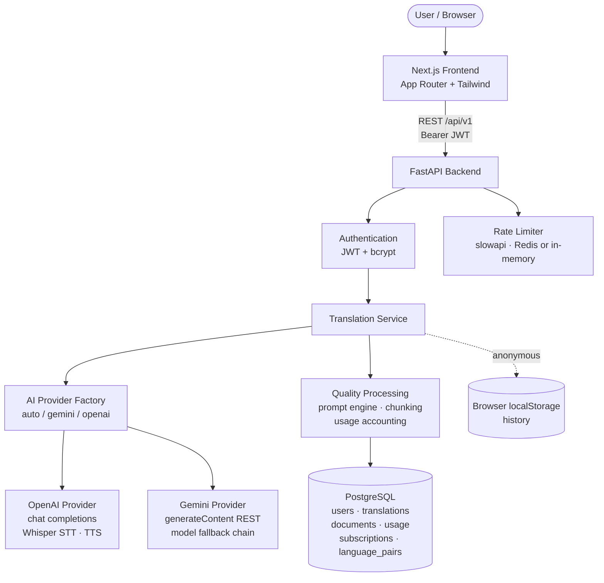
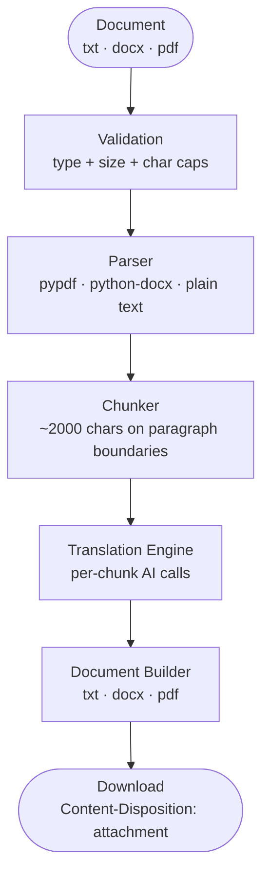
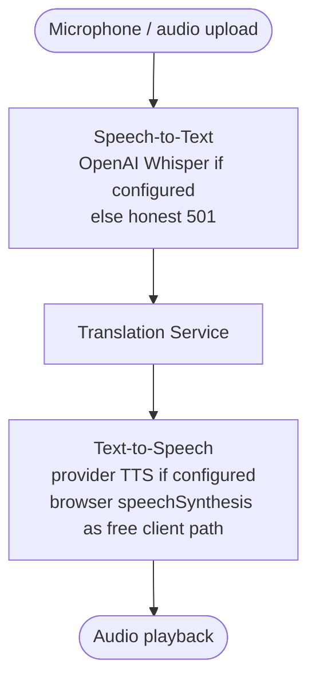

# PolyTranslate AI — Architecture

## Overview

PolyTranslate AI is a production-style AI translation SaaS: a **Next.js 14**
frontend, a **FastAPI** backend, **PostgreSQL** for persistence, and
**Redis** (optional) for rate-limit storage. AI work goes through a provider
abstraction, so OpenAI and Gemini are interchangeable and new providers can be
added without touching routes or services.

## System architecture



## Document translation pipeline



PDF output is generated from extracted text — layout reconstruction is
best-effort and the response carries an `X-PDF-Note` header saying so.

## Speech pipeline



The web client also uses the browser's **Web Speech API** (dictation) and
**speechSynthesis** (playback with the real device voice list) so speech
features work without any paid key.

## Backend layout

```
backend/app/
├── main.py            # app factory, CORS, routers, error handlers
├── core/              # config (pydantic-settings), security, rate_limit, logging, errors
├── db/                # SQLAlchemy 2.0 base + session (sqlite dev / postgres prod)
├── models/            # user, translation, document, usage_record, subscription, language_pair
├── schemas/           # Pydantic v2 request/response (mirror docs/api.md)
├── ai/                # base ABC, openai_provider, gemini_provider, factory, errors
├── prompts/           # translation.py (domain + tone/style), writing.py
├── languages/         # registry.py — 109 real ISO 639-1 languages, RTL flags
├── services/          # translation, detection, writing, backtranslation,
│                      # documents, speech, history, usage, seo, billing
├── api/v1/endpoints/  # one router module per resource (23 routes)
└── auth/              # jwt, password (bcrypt), deps, password-reset tokens
```

Key design choices:

- **Provider abstraction** (`ai/base.py`): every capability
  (`translate`, `detect_language`, `improve_text`, `paraphrase`, `summarize`,
  `transcribe_audio`, `synthesize_speech`) is one method. Adding a provider =
  subclass + register in `factory.py`. Nothing else changes.
- **No fake AI**: without a configured key the factory raises
  `ProviderNotConfigured` → translation endpoints return **503**, speech
  endpoints **501**. Tests inject a deterministic `MockProvider`.
- **Prompt engine** (`prompts/`): domain prompts (general/business/academic/
  marketing/technical) combined with tone (7) and style (4) modifiers.
  Prompts forbid adding/removing information and require preserving names,
  numbers, dates, URLs, formatting, and paragraph structure.
- **Usage accounting** (`services/usage.py`): every AI call records characters
  against the user's monthly quota (env-configured per plan); over quota →
  **402**. Nothing is hardcoded.
- **Rate limiting** (`core/rate_limit.py`): slowapi; anonymous callers keyed by
  IP at `RATE_LIMIT_ANON`, authenticated users keyed by user id at
  `RATE_LIMIT_AUTH`; Redis when `REDIS_URL` is set, in-memory otherwise.
- **History**: authenticated users get server-side history (searchable,
  deletable); anonymous users get browser-localStorage history only.
- **Billing** (`services/billing.py`): static plan definitions (Free/Pro/
  Business) behind a clean abstraction — Stripe plugs in later, no fake
  checkout exists today.

## Frontend layout

```
frontend/
├── app/
│   ├── page.tsx            # landing + embedded working translator
│   ├── [pair]/page.tsx     # 16 SEO language-pair pages (static)
│   ├── blog/ & blog/[slug] # 5 long-form articles
│   ├── tools/              # grammar, paraphrase, summarize,
│   │                       # back-translate, documents, speech
│   ├── login signup forgot-password reset-password
│   ├── dashboard history   # protected
│   ├── languages privacy terms
│   ├── sitemap.ts robots.ts
├── components/             # Translator, LanguageSelect, VoicePlayer,
│                           # AudioRecorder, FileUpload, Faq, UsageBar, …
├── lib/                    # api.ts (typed client), auth.tsx, seo.ts,
                            # phrases.ts, blog.ts
```

- All data (languages, plans, stats, history) renders from live API responses
  with honest loading/error states — no fabricated testimonials or stats.
- SEO: unique title/meta/canonical/OG/Twitter per page; JSON-LD
  (WebSite, WebApplication, FAQPage, BreadcrumbList); `sitemap.xml` (34 URLs);
  `robots.txt` blocks `/dashboard`, `/history`, `/api`.
- RTL: output containers get `dir="rtl"` when the target language is RTL.

## Data model

| Table | Purpose |
|---|---|
| `users` | id, name, email (unique), password_hash (bcrypt), plan, created_at |
| `translations` | history entries: user_id, langs, texts, tone/style, created_at |
| `documents` | uploaded doc jobs: user_id, filename, langs, char counts, status |
| `usage_records` | per-user monthly counters: chars, requests, speech |
| `subscriptions` | plan + status (abstraction for future Stripe) |
| `language_pairs` | SEO pair configs (seeded; CMS-overridable later) |

Migrations: Alembic (`backend/alembic/versions/0001_initial.py`).

## Configuration

Everything is env-driven — see `.env.example`. Notable knobs:

| Variable | Default | Meaning |
|---|---|---|
| `AI_PROVIDER` | `auto` | `auto` picks configured key (Gemini preferred), or force `gemini`/`openai` |
| `GEMINI_MODEL` | `gemini-3.8-flash` | with 404-fallback chain (Google retires models) |
| `FREE_MONTHLY_CHARACTERS` | `50000` | anonymous+free quota |
| `RATE_LIMIT_ANON` / `RATE_LIMIT_AUTH` | `30/minute` / `120/minute` | |
| `MAX_FILE_SIZE_MB` / `MAX_DOCUMENT_CHARS` | `10` / `50000` | document caps |

## Security notes

- bcrypt password hashing, JWT (configurable expiry), no plaintext secrets.
- Password-reset never reveals whether an email exists; tokens are
  single-use, 1-hour, signed with `itsdangerous`.
- Pydantic validation on every input; file type + size validation on uploads;
  SQLAlchemy ORM (no raw SQL); CORS allowlist; no stack traces to clients.
- Secrets live only in env — never in the repo, responses, or logs.

## Honest limitations (documented, not hidden)

1. Translation quality comes from the configured LLM; low-resource languages
   vary in quality — the registry lists what providers *handle*, docs say
   quality differs.
2. Language *detection confidence* is only shown when the provider genuinely
   supplies it (otherwise `null`) — never invented.
3. Back-translation is a consistency check, not proof of accuracy (UI says so).
4. PDF document output is best-effort layout.
5. Speech STT/TTS server-side needs an OpenAI key; the browser paths
   (Web Speech API, speechSynthesis) work without keys where supported.
6. Password-reset emails need SMTP configuration (not bundled); dev logs the
   token server-side only.
